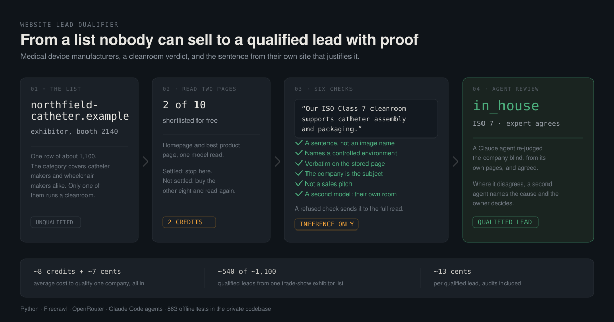
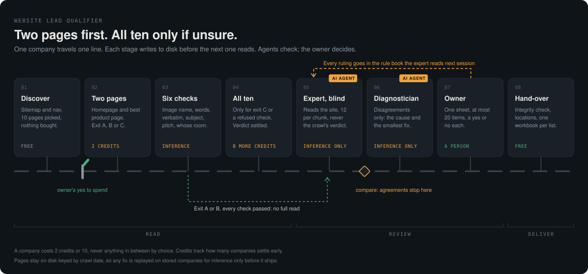

# Cleanroom classifier



Takes a list of medical device manufacturer domains, crawls a handful of pages
from each, and returns a four-way verdict on whether the company operates a
cleanroom, with a verbatim quote behind every claim.

Labels: `in_house` / `likely_in_house` / `outsourced` / `no_cleanroom_needed` /
`unknown`. Optimised for precision over recall, because the cost of a wrong
"yes" is a salesperson's afternoon and the cost of a wrong "no" is a row that
gets re-run next quarter.

**Measured on a 23-domain dual-reader holdout: 78.3% exact-label accuracy,
90% lead precision, and every remaining error routed to manual review.**
Cost to classify a domain end to end: about 9 crawl credits and $0.10 of
inference.

---

## The problem

A supplier selling cleanroom consumables buys a list of medical device
manufacturers filtered by industry code. That filter is too broad to sell
against: a wheelchair manufacturer and a catheter manufacturer carry the same
code, and only one of them buys gloves, wipes and garments by the pallet.

Keyword matching does not fix it. The certification every medical device firm
advertises, ISO 13485, says nothing about facilities. It appears on the site of
a company running three ISO 7 suites and on the site of a company that
outsources all manufacturing. Searching for "cleanroom" is worse: it matches
the sentence "our supplier's cleanroom" as readily as "our cleanroom."

The signal that actually works is the product catalogue plus explicit
contamination-control language, read together, with the subject of the sentence
resolved. That is a reading task, so the classifier is an LLM call over
extracted evidence rather than a regex.

## What it produces

One row per domain:

| Field | Example |
|---|---|
| `verdict` | `in_house` |
| `confidence` | `0.82` |
| `iso_class` | `ISO 8` |
| `evidence` | `"Our ISO Class 8 cleanroom supports catheter assembly"` plus the URL it came from |
| `needs_manual_review` | `false` |
| `review_reason` | `null` |

The evidence field is the point. A verdict a salesperson cannot check is a
verdict they will not trust, and every quote in the output is guaranteed to
appear on the page it cites, because the pipeline verifies that itself rather
than taking the model's word for it.

## How it works

Six stages, each of which writes to disk before the next one reads. Everything
below the raw store is cheap to re-run and everything above it is not, which is
the constraint the whole design is organised around.



1. **Normalize.** URLs to registrable domains, redirects resolved, duplicates
   collapsed and reported rather than hidden. Nothing is filtered out here.
2. **Discover.** Sitemap plus homepage nav, both free. URLs are scored against
   the sector pack and capped per page type, so a 400-URL product catalogue
   cannot win every slot. Ten pages per domain, homepage first.
3. **Fetch.** Firecrawl scrape into a date-keyed raw store, under a shared rate
   limiter, with per-domain credit accounting and a budget stop.
4. **Extract.** One LLM call per page. Reports what the page says, decides
   nothing, and every claim carries a quote that is then verified against the
   page text.
5. **Classify.** One LLM call per domain over the collected evidence, plus an
   independent deterministic scoring pass as a second opinion. Disagreement
   between the two routes the row to review.
6. **Evaluate.** Scored against a labelled holdout with Wilson confidence
   intervals, and McNemar's test when comparing two runs, so a one-domain
   improvement is not reported as progress.

## Stack

| Layer | Choice | Why |
|---|---|---|
| Language | Python 3.11+ | |
| Crawling | Firecrawl | Renders JS, returns markdown, handles the bot-wall cases |
| Inference | Anthropic API or OpenRouter | One env var swaps them, see `llm.py` |
| Models | Haiku 4.5 for extraction, Sonnet for classification | 90% of calls are extraction, so the cheap model goes there |
| Schemas | Pydantic 2 | Structured output parsed and validated in one place |
| Storage | Local filesystem or Google Cloud Storage | Identical interface, nothing above `store.py` knows which |
| Config | YAML sector pack | The vocabulary is data, not code |
| Tests | pytest, 654 passing, offline by default | |

Every dependency is pinned exactly. This pipeline is re-run against stored raw
pages for months, and a silent minor bump in a URL parser changes the output
without changing a single prompt, which makes run-to-run diffs meaningless.

## Cost control

The pipeline spends real money per row, so cost governance is a feature rather
than an afterthought. Four mechanisms:

- **Idempotency by crawl date.** A domain already crawled today is skipped with
  no billed call, so re-running after a partial failure finishes the batch
  instead of paying for it twice.
- **A budget stop.** `--budget N` halts the batch once N credits are spent. It
  is a stop line rather than a hard ceiling: in-flight domains finish, so the
  overshoot is bounded by their cost.
- **A shared rate limiter.** The plan caps requests per minute as well as
  credits, and the two fail differently. Credits run out once; a rate limit runs
  out every sixty seconds. A refused call costs nothing and silently loses the
  page, which is the worse outcome, so 429s are waited out rather than recorded.
- **`--dry-run` everywhere.** Discovery and extraction both price the pass
  before it runs, for free, and print the exact page count and credit estimate
  the real run will spend.

Re-prompting is deliberately cheap. Because raw pages are on disk and keyed by
crawl date rather than pack version, a prompt revision costs three minutes and
about two dollars instead of a four-hour re-crawl.

## Running it

```bash
python -m venv .venv
.venv/bin/python -m pip install -e ".[dev]"
cp .env.example .env        # then fill it in

.venv/bin/python -m pytest                        # 654 tests, offline, no keys needed

.venv/bin/python -m cleanroom.cli credits                                  # free
.venv/bin/python -m cleanroom.cli crawl --domains eval/goldset.jsonl --dry-run
.venv/bin/python -m cleanroom.cli crawl --domains eval/goldset.jsonl --budget 600
.venv/bin/python -m cleanroom.cli extract --dry-run
.venv/bin/python -m cleanroom.cli extract --budget-usd 5
.venv/bin/python -m cleanroom.cli classify --dry-run
.venv/bin/python -m cleanroom.cli classify --budget-usd 5

.venv/bin/python eval/evaluate.py --labels eval/goldset_tier_b_holdout25.jsonl
```

Every metered stage prices itself for free with `--dry-run` before it spends
anything, and `--run-id` re-runs one stage against stored output rather than
starting over.

The test suite is fully offline. The GCS backend runs against an in-memory
double of the Google client, so both storage backends are exercised in CI with
no bucket and no credentials.

## Further reading

- [BUILD.md](BUILD.md) — the original build spec, written before any code, and
  the phase gates each stage had to pass
- [docs/ARCHITECTURE.md](docs/ARCHITECTURE.md) — module map, data flow, the
  storage and provider seams
- [docs/EVALUATION.md](docs/EVALUATION.md) — how accuracy is measured, and why
  the harness reports its own circularity
- [docs/DESIGN-DECISIONS.md](docs/DESIGN-DECISIONS.md) — the judgment calls,
  including the ones that were wrong first

## Notes on this repository

This is a portfolio copy of a working pipeline. The engine, the test suite and
the sector packs are intact and unmodified. The evaluation sets are real in
every respect that matters to the code (labels, adjudication status, provenance,
row counts, employee counts, reviewer notes) but every company identity in them
has been replaced with a pseudonym, and the same substitution has been applied
to company names appearing in source comments. No client data, no API keys and
no internal run history are included.

Some comments cite internal working documents that are not included here: run
logs and design reviews under `outputs/`, the handoff notes under
`docs/handoff-v2.2/`, and `NEXT.md`. The citations are left in place rather than
scrubbed, because a comment that names the document a decision came from is more
useful than one that quietly drops it.

Seven tests in `tests/test_crawl_policy.py` are marked `xfail`. They are
acceptance tests for steps 2 to 4 of the conditional crawl ladder, written
before the implementation, and they are shipped red on purpose: the spec is the
artifact, and a green suite that omits the unfinished spec would be the less
honest of the two.
