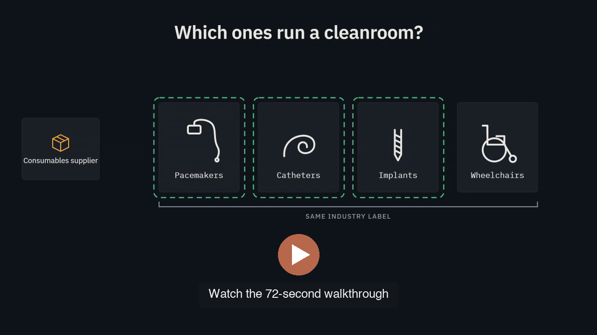
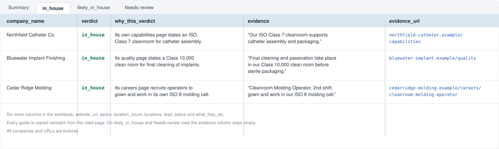

# AI lead qualification agent (B2B)

---

A case study of an AI lead-qualification system built for an industrial
consumables supplier. It reads each company's website, decides whether the
company is worth a salesperson's call, and attaches the sentence from the
company's own site that proves it. Three Claude agents review every batch
before anything reaches sales.

This repository shows the problem, the design, the output and the results.
The code lives in a private codebase with 863 offline tests; a code
walkthrough is available on request.

**Results in production:** about 1,100 companies screened from a trade-show
exhibitor list, about 540 of them qualified leads, for about $72 in total.
That is about seven cents per company and thirteen cents per qualified lead,
audits included.

---

## Problem

The supplier sells consumables that are used up every shift inside
cleanrooms. Its best prospects are manufacturers that run a cleanroom of
their own. Its lists do not say which
companies those are.

- **Industry codes are too broad.** A wheelchair maker and a catheter maker
  carry the same code, and only one of them runs a cleanroom.
- **Keyword search is wrong in both directions.** ISO 13485, which every
  medical device manufacturer advertises, says nothing about facilities.
  "Cleanroom" matches "our supplier's cleanroom" and "the cleanrooms we sell
  into" as readily as "our cleanroom."
- **Checking by hand does not scale.** A careful read of one website takes a
  person ten to fifteen minutes. A trade-show list has over a thousand rows.

The signal that works is what the company makes, plus first-party
contamination-control language, with the owner of the room resolved. That is
a reading task, so the verdict is an LLM call over the company's pages, with
deterministic checks on every claim it makes.

## Approach

### Spend only where the answer is not yet known

Every page read costs a crawl credit, so the crawler buys pages in two steps.

1. **Discover for free.** Sitemap, `robots.txt` and homepage navigation over
   plain HTTP. Every URL is scored against eleven page types and capped per
   type, so a 400-page product catalogue cannot win every slot. Ten pages are
   shortlisted and nothing is bought yet.
2. **Read two pages.** The homepage and the best product page. One model call
   reads them and takes one of three exits:
   - **A:** the company states it runs its own cleanroom. Stop.
   - **B:** the catalogue could never need one. Stop.
   - **C:** not settled. Buy the other eight pages and read them together.

A company therefore costs two pages or ten, and the batch's credit bill tracks
how many companies can be settled early.

### Check every positive claim six ways

A quote has to pass six checks before it can make a company a qualified lead
with proof:

1. It is a sentence, not an image filename.
2. It describes a controlled environment at all.
3. It appears character for character on the stored page.
4. The company is the subject of the sentence.
5. It is not sales wording aimed at the reader's cleanroom.
6. A second model, given every stored page, confirms whose cleanroom it is.

A quote that passes all six is then graded: it is proof (`in_house`) when it
names a cleanroom class or room, and a likely qualified lead when the wording
is thin.

A refused guard is not a "no". It cancels the early exit and sends the company
to the full ten-page read, because the cost of a refused guard should be eight
credits, not a lost lead.

### Put agents where the judgment is

Once the crawler worked, accuracy was limited by three things a pipeline does
badly: applying a growing rule book, explaining its own mistakes, and using
the owner's time well. Three agents took those jobs
([docs/AGENTS.md](docs/AGENTS.md)).

| Agent | Job | Cannot |
|---|---|---|
| **Cleanroom expert** (`claude-opus-5-5`) | Re-judges every company blind from its own pages, applying the owner's written rulings; drafts a new ruling when none fits | See the crawler's answer, edit anything, spend |
| **Diagnostician** (`claude-sonnet-5-5`) | For every row where the expert or the owner disagrees with the crawler, names one cause and the smallest fix | Edit anything, re-run, spend |
| **Run operator** (a Claude Code skill) | Runs the batch, launches the other two, writes one approval sheet of at most 20 items | Spend without the owner's yes, change a verdict or a rule |

Agents propose; only the owner adopts. Every ruling is logged, and its
reasoning goes into a knowledge file the expert reads every session, so the
agents improve because their rule book grows, never because they rewrite
themselves.

### One batch, end to end

A batch is 100 companies.

1. **Plan.** One command checks the credit balance and prices the batch with
   a free dry run, then stops at a spend gate. Nothing is billed until the
   owner says yes.
2. **Crawl.** About an hour. Each company's verdict and its evidence land in a
   manifest pinned to that crawl date, so no later step can mix two runs.
3. **Review.** The cleanroom expert re-judges the batch blind, twelve
   companies per chunk, three chunks at a time.
4. **Diagnose.** Every disagreement between the expert and the crawler goes to
   the diagnostician, which traces it to one cause: page selection,
   vocabulary, prompt, attribution, quote check, a missing rule, or bad data.
5. **Approve.** The run operator writes one sheet. It skips rows the owner has
   already ruled on and groups the rest by cause, one yes or no each. On a
   98-company test batch it cut 29 items to 3.
6. **Hand over.** Approved changes are applied by script, the sales workbook
   is rebuilt, and an integrity check blocks the hand-over if any run
   disagrees with its own evidence.

## What it produces

One workbook per source list, built by one command. A sample with fictional
rows is in [samples/sample-output.xlsx](samples/sample-output.xlsx).

| Sheet | What it holds |
|---|---|
| Summary | One row per verdict over every company crawled, total spend, cost per company, cost per qualified lead |
| `in_house` | Qualified leads whose own pages prove their own cleanroom, each with the sentence and its URL |
| `likely_in_house` | Qualified leads without proof, where what they make and how make a cleanroom likely; ranked strong, medium, low |
| Needs review | Companies the pages do not settle, for a person or a phone call |

**The evidence column is filled only on `in_house` rows, and only with a
sentence that proves it.** A quote the pipeline read and refused, because it
describes a partner's or a customer's cleanroom, never appears under a heading
a salesperson will take as proof.

## Results

| | List 1 | List 2 |
|---|---|---|
| Source | Purchased industry list, medical device manufacturers | Trade-show exhibitor list, medical device manufacturers and their suppliers |
| Companies | about 250 | about 1,100 |
| Qualified leads | about 100 | about 540 |
| Total cost | about $32 | about $72 |
| Cost per qualified lead | about $0.33 | about $0.13 |

List 2 cost less per lead for two separate reasons. Partly the cost per
company halved, from about thirteen cents to about seven, after the crawl
moved to cheaper models following a four-family bakeoff. Partly the list
itself was richer: about 49% of list 2 became qualified leads, against about
40% of list 1.

- **Every proof is checkable.** Each of the roughly 310 qualified leads with
  proof carries a verbatim sentence and the URL it came from.
- **Nothing is thrown away by default.** The only irreversible label is "no
  cleanroom needed", and no path reaches it from an absence of evidence.
  Companies the pages do not settle go to review, about one in five on list 2.
- **Wrong verdicts were flagged, on a small test.** On a 23-company holdout
  of the first version, every wrong verdict had been flagged for review.

How each number was measured, and what the numbers do not show, is in
[docs/EVALUATION.md](docs/EVALUATION.md).

## Plug & play

The market is configuration, not code. Everything the system knows about
medical device cleanrooms lives in one sector pack: the products that imply
a cleanroom, the products that rule one out, the trap terms everyone in the
sector carries, the outsourcing cues and the page types worth reading.

A new market means a new pack. [samples/demo-pack-semiconductor.yaml](samples/demo-pack-semiconductor.yaml)
is an excerpt for the next cleanroom segment: semiconductor and electronics
manufacturers. The question stays the same, does this company run a cleanroom
of its own; what changes is the vocabulary, such as Class 100 fabs, wafers and
fabless companies that name their foundry. The crawler, the six checks, the
agents and the workbook stay as they are.

## What I'd do next

1. **Run the semiconductor segment.** The demo pack is a start. The knowledge
   file was written to carry over, but the prompts are still worded for
   medical devices and need their own version.
2. **Enrichment for qualified leads only.** Contact enrichment is priced per
   record, so it should run after qualification, not before.
3. **Measure the sales outcome.** Every number here is the pipeline's own
   judgment, reviewed by the owner. The next measure that matters is calls,
   meetings and orders per qualified lead.
4. **A fresh independent holdout.** The only independently labelled test set
   measured the first version of the crawler.

## Further reading

- [BUILD.md](BUILD.md): the original build spec, written before any code
- [docs/ARCHITECTURE.md](docs/ARCHITECTURE.md): the stages, the store, the
  model routing
- [docs/AGENTS.md](docs/AGENTS.md): the three agents, their limits, and how
  they were tested
- [docs/EVALUATION.md](docs/EVALUATION.md): how accuracy and cost were
  measured
- [docs/DESIGN-DECISIONS.md](docs/DESIGN-DECISIONS.md): the judgment calls,
  including the ones that were wrong first

---

All rights reserved; shown for portfolio purposes only. See [LICENSE](LICENSE).
Company names in every example are fictional. Code walkthrough available on
request.
