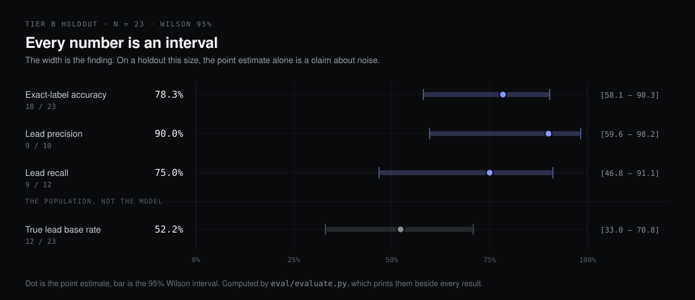

# Evaluation

The hard part of this project was not the pipeline. It was building an
instrument honest enough to tell whether the pipeline was getting better.

## Headline numbers



Measured against the Tier B holdout, 23 domains adjudicated by two independent
readers against the live sites:

| Metric | Value | 95% CI |
|---|---|---|
| Exact-label accuracy | 18/23 = 78.3% | [58.1%, 90.3%] |
| Lead precision | 9/10 = 90.0% | [59.6%, 98.2%] |
| Lead recall | 9/12 = 75.0% | [46.8%, 91.1%] |
| True lead base rate | 12/23 = 52.2% | [33.0%, 70.8%] |
| Errors routed to manual review | 5/5 = 100% | |

The confidence intervals are wide because n is 23. They are printed anyway, and
that is the point: a single-number accuracy claim on a 23-row holdout is a claim
about noise, and reporting the interval next to it is what stops the number
being over-read.

The last row matters more than the first. At this sample size the accuracy
figure moves on one domain. What does not move on one domain is whether the
system knows when it is unsure, and every incorrect verdict in the holdout was
already flagged for human review.

## Tiered label sets, never pooled

Five labelled files, kept separate because they were produced by different
processes and are not interchangeable evidence:

| Tier | Rows | How labelled | What it is for |
|---|---|---|---|
| A (`goldset.jsonl`) | 56 | Confirmed against live sites during development | Development, prompt iteration |
| A-SMB (`goldset_smb.jsonl`) | 51 | Same, restricted to the SMB size band | Development |
| B (`goldset_tier_b_holdout25.jsonl`) | 25 | Dual-reader adjudicated, independent of any run | **The only accuracy instrument** |
| C (`goldset_tier_c_batch1.jsonl`) | 38 | Single human reviewer, 12 rows reconciled to pipeline output | Regression detection only |
| Holdout (`holdout.jsonl`) | 30 | Reserved, unlabelled | The next honest test |

Pooling these would produce a bigger n and a worse instrument.

## The circularity check

Tier C contains 12 rows whose labels were changed to match what the pipeline
already said. Scoring that run against those rows cannot measure accuracy; it
measures whether the run agrees with itself.

So `eval/evaluate.py` carries `circular_rows()`, which reads the
`label_provenance` field and prints a banner naming every row whose label was
reconciled to a pipeline verdict. A file with no provenance field, like Tier A,
predates the field and is not flagged.

This is enforced in the test suite rather than left to discipline
(`tests/test_evaluate.py`):

```python
def test_tier_c_is_marked_circular_on_disk():
    """This guards the file itself, not the code: if someone strips the
    provenance field, the 96.8% starts looking like a real number again."""
```

The expected count is asserted exactly, with a comment stating that it must fall
as rows are independently confirmed and must never rise. A row leaves the
circular set in exactly one legitimate way: a human re-checks the live site and
the provenance is upgraded, whether or not the label moves.

Tier C's apparent 96.8% exact-match is, correctly, never quoted anywhere.

## Comparing two runs

`eval/compare_runs.py` prints the exact-match delta between two runs and then,
directly underneath it, McNemar's exact test.

This exists because of a specific mistake. A round of eight fixes moved the
holdout from 17/23 to 18/23 and the result was written up as an improvement that
was "roughly noise." It was not roughly anything. McNemar's exact p was 1.00:
two domains fixed, one regressed. That run measured nothing at all about
accuracy, and the honest report was "no evidence of change," not "small
improvement."

A metric that can only move up is not a metric. Printing the significance test
next to the delta is what makes the difference visible without anyone having to
remember to look.

## Review-queue economics

The verdict is not the product. The product is a sales team's time, and the
question is how much of the output a human has to check.

Tuning the auto-accept confidence threshold and the review gates moved the queue
from 84% of rows to 60%, and auto-accept from 16% to 36%, **with zero errors
leaking into the auto-accepted set** on the holdout. That was a read-only change
costing no credits and no inference: the runs were already on disk, so the gates
could be re-scored against stored output.

`eval/review_priority.py` ranks what remains, so the queue is worked in order of
expected value rather than alphabetically.

## What the numbers do not cover

Stated plainly, because a portfolio that omits this is selling something:

- **n = 23.** Every interval above is wide, and the holdout describes the size
  band it was drawn from. It says little about enterprise multi-division firms.
- **Site text caps `in_house` recall near 25%.** Some companies simply do not
  describe their facilities on their website. No amount of prompt work recovers
  a fact that was never published, which is why `unknown` is a first-class label
  rather than a failure state.
- **`unknown` scores near zero on both precision and recall** on the two true
  instances in the holdout. Two instances is not a measurement, and it is the
  clearest open weakness.
- **The GCS backend has never been smoke-tested against a real bucket.** It is
  tested against an in-memory double, which covers framing and paths and covers
  nothing about auth or permissions.
